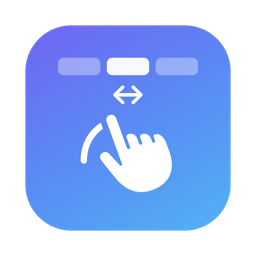

<p align="center">
  
</p>

<h1 align="center">Scrubby</h1>

<p align="center">
  <b>Swipe through browser tabs and windows with your Mac's trackpad.</b><br>
  Free, open source, and tiny. Lives in your menu bar.
</p>

<p align="center">
  
</p>

## What it does

| Gesture | What happens |
| --- | --- |
| **Three fingers, sideways** in your browser | Moves to the tab on the left or right. Keep dragging to keep moving, like dragging a scrollbar across your tabs. |
| **Four fingers, sideways** anywhere | Moves to your next or previous window, like ⌘-Tab but for windows. The window's name flashes up as you go. |

A quick flick moves one tab or window, and a longer swipe moves across several.

## Install

With [Homebrew](https://brew.sh):

```bash
brew trust kudostoy0u/tap
```

```bash
brew install --cask kudostoy0u/tap/scrubby
```

The first command tells Homebrew it's OK to install from Scrubby's tap. You only need it once.

Or download **Scrubby.zip** from the [latest release](https://github.com/Kudostoy0u/Scrubby/releases/latest), unzip it, and drag Scrubby into your Applications folder.

Scrubby is signed and notarized by Apple, so it opens without warnings. It needs macOS 14 Sonoma or later.

## Set up (one minute)

Open Scrubby. Its setup screen checks off each step as you finish it:

1. **Let Scrubby control your Mac.** It needs this to see your swipes and press the tab-switching shortcut for you. Click **Open Settings**, then turn on Scrubby in the list. The list is called **Accessibility** on older macOS and **Device Control and Data Access** on newer macOS.
2. **Free up the swipes macOS is using.** Click **Open Trackpad Settings**, then go to **More Gestures**:
   - set **Swipe between pages** to **Scroll left or right with two fingers**, or turn it off
   - turn off **Swipe between full-screen applications**

That's it. Look for the hand icon in your menu bar.

## Works with

Brave, Chrome, Arc, Dia, Edge, Vivaldi, Opera, Chromium, Firefox, Zen and Safari. You can turn tab swiping off for any of them.

## Settings

Click the hand icon in the menu bar → **Settings…** to:

- turn either gesture on or off
- change how far you swipe before the first switch, and between further ones
- choose which browsers tab swiping works in
- have Scrubby open when you log in
- pause Scrubby for a while (also right in the menu)

## Questions

**Is it safe to give Scrubby this permission?**
Scrubby only reads trackpad scrolling and touches, and only sends tab-switching shortcuts and window-focus requests. It doesn't read what you type, collect anything, or connect to the internet. All the code is here, and it's under 1,000 lines.

**My normal two-finger scrolling still works, right?**
Yes. Scrubby only takes over sideways swipes with three or four fingers.

**Swiping doesn't do anything.**
Open Settings from the menu bar icon and check that all three setup steps have a green checkmark. If the icon is a warning triangle, Scrubby doesn't have its permission yet. If you updated Scrubby and it stopped working, remove it from the permission list with **−** and add it again.

**Swiping goes the wrong way, or switches too easily or not easily enough.**
Scrubby follows your scroll direction setting. You can change the swipe distances under **Sensitivity** in Settings.

**How do I uninstall it?**
Quit it from the menu bar, then run `brew uninstall --cask scrubby`, or drag it from Applications to the Trash.

## How it works

macOS doesn't let apps receive three- and four-finger swipes directly, so Scrubby puts two signals together:

- **How many fingers:** from the trackpad's touch events. These often arrive with no fingers listed, even mid-swipe, so Scrubby ignores those and remembers the last real count for a moment.
- **How far they moved:** from the smooth sideways scroll events the trackpad sends while several fingers drag. Every so many points of movement switches one tab or window. For a quick flick, the coasting scroll after your fingers lift counts too.

Each swipe is decided when it starts (tab swipe, window swipe, or normal scrolling) and stays that way until your fingers lift. Scrubby blocks the scrolling from tab and window swipes, so the page doesn't move and the browser doesn't go back or forward.

Tabs switch using each browser's own shortcut: ⌘⌥← / ⌘⌥→, or ⌃⇧⇥ / ⌃⇥ in Safari.

## For developers

```bash
git clone https://github.com/Kudostoy0u/Scrubby.git
cd Scrubby
scripts/build-app.sh        # builds build/Scrubby.app, signed for this Mac only
```

| File | What it does |
| --- | --- |
| `Sources/Scrubby/GestureEngine.swift` | Listens for trackpad events and turns swipes into actions |
| `Sources/Scrubby/WindowSwitcher.swift` | Finds the windows on the current Space and focuses the next one |
| `Sources/Scrubby/Browsers.swift` | Supported browsers and their tab shortcuts |
| `Sources/Scrubby/SettingsView.swift` | The Settings and setup window |
| `Sources/Scrubby/SystemStatus.swift` | Checks the permission and trackpad settings |
| `Sources/Scrubby/HUD.swift` | The window name that flashes on screen |

macOS ties the permission to the app's signature, and local builds get a new signature each time. After installing a new local build, remove Scrubby from the permission list and add it again.

**Releasing:** `scripts/release.sh 0.2.0` builds the app, signs it with your Developer ID, notarizes it with Apple and publishes the GitHub release. It also updates the [Homebrew tap](https://github.com/Kudostoy0u/homebrew-tap) when that repo is checked out next to this one. The one-time setup is listed at the top of the script. To redraw the app icon, run `swift scripts/make-icon.swift`.

## License

MIT
